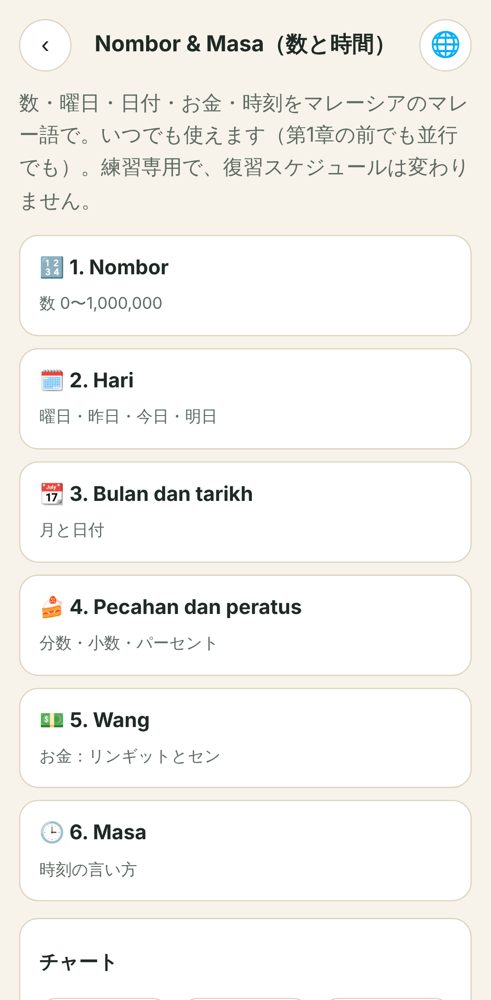
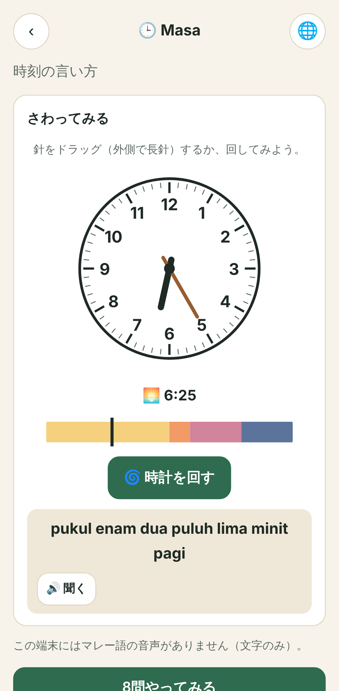
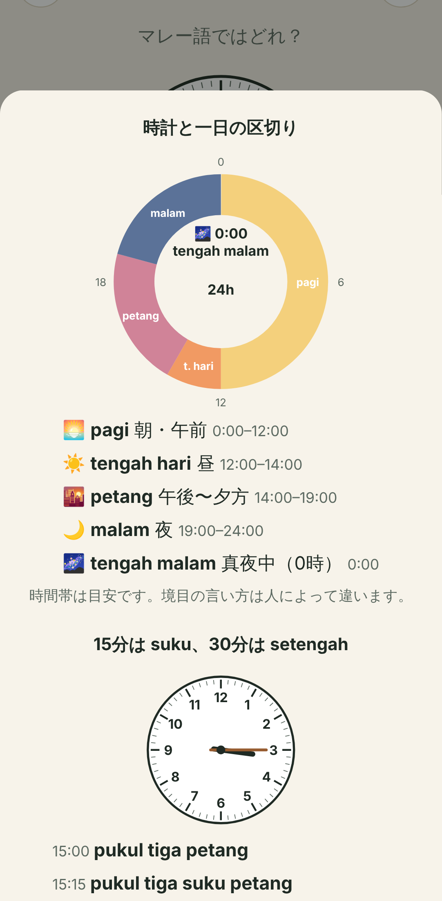
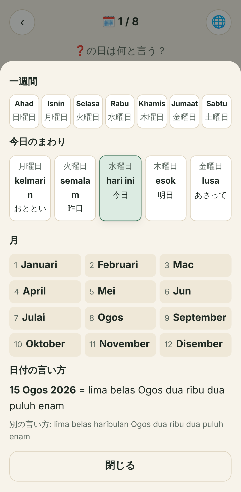
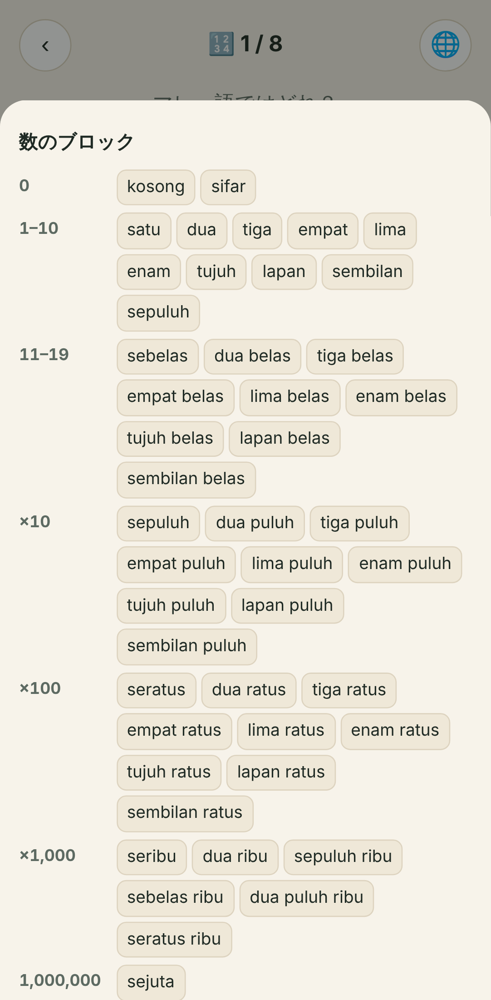

# Nombor & Masa: report (15 Nov 2026)

Nombor & Masa is a standalone mode for numbers, days, months and dates, fractions, decimals and percent, money and clock times. It is on the home screen (🔢 tile) and open from day one: a learner who has not started chapter 1 can use it. It is practice only, and nothing in it changes the review schedule.

Sam's decisions of 15 Nov 2026 are built in:

- The standalone mode is open from day one.
- Standard forms come first and spoken forms are marked: RM4.50 is «empat ringgit lima puluh sen», and «empat ringgit setengah» is accepted with the label "Spoken". 3:30 pm is «pukul tiga setengah petang» or «pukul tiga tiga puluh petang», both standard.
- The charts and memory hooks are Claude's drafts, for Sam to review.

The open questions for Sam are in section 4.

## 1. What was built

| Piece | File |
|---|---|
| Generators and questions (pure, no DOM) | `src/core/nombor.ts` |
| Mode screens, explorers, the 8-question round, the build-from-blocks question | `src/views/nombor.ts` |
| Clock face, sky strip, calendar page, week strip, price tag, fraction pie, number reels; the three charts | `src/views/nombor-charts.ts` |
| Styles (`.nm-*`) | `src/styles.css` (end of file) |
| Interface text: 84 `nm.*` keys plus `mode.nombor` (ms has the 72 that are not hooks) | `i18n/en.json`, `ja.json`, `ms.json` (hooks in en and ja; the Malay interface falls back to English for hooks) |
| Route `#/nombor`, `#/nombor/<part>`; home tile | `src/main.ts`, `src/views/home.ts` |
| Unit tests (80) | `tests/unit/nombor.test.ts` |
| End-to-end test (plays all six parts) | `tests/e2e/nombor.cjs` |
| Phone-size screenshots (Pixel 7) | `docs/nombor-masa/` |

**The six parts**, each with a hands-on explorer, a chart, two memory hooks and an 8-question round:

1. **Nombor**: numbers 0 to 1,000,000 in six levels (0–10, 11–19, 20–99, 100–999, 1,000+, 1,000,000). The explorer is a slot machine: "Roll the numbers" spins the reels. At level 0–10 there is also a phone-number roll.
2. **Hari**: Ahad to Sabtu, plus semalam, hari ini, esok and lusa. In the explorer, a tap on a day makes it "today", and the tiles show what semalam, esok and lusa point to. «kelmarin» (chapter 4 card) is in the chart and appears as a distractor.
3. **Bulan dan tarikh**: the twelve Malaysian month names and full dates. The explorer is a calendar: ‹ and › turn the months, "Turn the calendar" jumps to a random date, and a tap on a day reads the date.
4. **Pecahan dan peratus**: ½ ⅓ ⅔ ¼ ¾, decimals and percent, shown with fraction pies and random decimal and percent rolls.
5. **Wang**: ringgit and sen from RM0.50 to RM1,250.00, shown on a price tag with "New price".
6. **Masa**: a clock with draggable hands. The minute hand carries the hour; the hour hand runs through all 24 hours. "Spin the clock" animates to a random time, and a sky strip under the clock shows the part of the day.

**The round.** Each round has 8 questions in three directions:

- **Read:** see the number, clock, calendar or price, then pick the Malay from four options.
- **Pick:** read the Malay, then pick the number, clock, date, day or price.
- **Build:** build the Malay from word blocks. This is the sixth question in Nombor (from level 11–19 up) and in Wang.

In read questions, the numbers roll, the clock spins and the calendar turns before the options appear. Feedback shows:

- the standard reading with 🔊;
- each accepted variant with its label: Spoken, Also standard, Formal, Everyday or Also said;
- a button to the part's chart;
- "Next".

Wrong answers follow the app's rule: no red, and the right answer is shown in neutral blue.

**Distractors** target the confusions in the brief:

- belas against puluh (14 and 40);
- se- against satu (seratus and «satu ratus»);
- suku against setengah;
- petang against malam (and pagi against petang).

They also cover:

- the digit order (46 and 64);
- place value (ratus and ribu);
- RM4.50 against RM4.05;
- ringgit and sen swapped;
- a phone number read as a number instead of digit by digit;
- 2.5 read as 25;
- neighbouring and look-alike months (Jun and Julai, Mac and Mei).

No distractor is ever another accepted form of the answer (tested).

**Speech.** The mode uses the app's speech (`src/core/tts.ts`): a local Malay voice first, then an Indonesian voice, and nothing is read until a 🔊 tap, as iOS requires. With no voice the mode is text only and says so: "No Malay voice on this device: text only." It works offline and costs nothing.

**Icons.** The mode uses no ⚡ or 🔥 (the e2e test checks this). The points pill, combo and speed badges are not used here. The icons are 🔢 🗓️ 📆 🍰 💵 🕒 🎰 📱 🌀 📊 🎉.

**Charts**, each opened from its part and from every question's feedback:

- **Number blocks:**
  - the rows 0, 1–10, 11–19, ×10, ×100, ×1,000 and 1,000,000;
  - "se- means one";
  - "no 万: 10,000 = sepuluh ribu";
  - a coloured build example: 2,345 = dua ribu | tiga ratus | empat puluh | lima;
  - fractions, decimals and percent;
  - money, with the spoken form labelled.
- **Clock and parts of the day:** a 24-hour ring with the *proposed* parts and the note "the times are a guide", the :00, :15, :30 and :20 readings, and "pukul for the clock time, jam for hours".
- **Calendar strip:** the week Ahad to Sabtu with interface-language names, a kelmarin…lusa strip around today, the twelve months, and «15 Ogos 2026» read in full with the haribulan variant.

## 2. The rules each generator follows

All in `src/core/nombor.ts`.

**Numbers (`numberToWords`, 0 to 1,000,000)**

- 0 is «kosong», labelled everyday; «sifar» is shown with it, labelled formal.
- se- replaces «satu» before a unit: sepuluh, sebelas, seratus, seribu, sejuta. A group never starts with «satu» + unit, but «dua puluh satu ribu» (21,000) and «seratus satu ribu» (101,000) are right.
- 12 to 19 are «X belas»; tens are «X puluh»; hundreds are «X ratus»; thousands are «(0–999 in words) ribu».
- A zero digit is never said inside a number: 1,001 is «seribu satu».
- The thousands group by thousands, not 万: 100,000 is «seratus ribu».

**Phone numbers (`phoneToWords`)** are read digit by digit, with 0 as «kosong». The written groups become pauses: 012-345 6789 is «kosong satu dua, tiga empat lima, enam tujuh lapan sembilan». Prefixes are 012, 013, 016, 017 and 019, then 7 digits.

**Days.**

- `DAYS` = Ahad, Isnin, Selasa, Rabu, Khamis, Jumaat, Sabtu (index = JavaScript `getDay()`; Sunday is «Ahad», never «Minggu»).
- Relative days: kelmarin −2, semalam −1, hari ini 0, esok +1, lusa +2. Questions ask −1 to +2.
- The pick question reads «Hari ini hari Isnin. Lusa hari apa?» and the answer reads «Lusa hari Rabu.».

**Months and dates.**

- Months are Januari, Februari, Mac, April, Mei, Jun, Julai, Ogos, September, Oktober, November, Disember.
- A date is day number in words, then month, then year as a whole number. «15 Ogos 2026» = «lima belas Ogos dua ribu dua puluh enam».
- Variant (labelled "Also said"): «lima belas haribulan Ogos dua ribu dua puluh enam» (ledger L-1410 «haribulan»).
- Random years run from 2000 to 2035.

**Fractions.**

- ½ «setengah» / «separuh» (both from the ledger, L-0138).
- ⅓ «satu pertiga», also «satu per tiga» and «sepertiga».
- ⅔ «dua pertiga», also «dua per tiga».
- ¼ «suku», also «satu perempat».
- ¾ «tiga suku», also «tiga perempat».
- The first spelling of each follows Sam's brief; the ledger writes «satu per tiga» (see question 4).

**Decimals.** The whole part is read in words, then «perpuluhan», then each digit after the point one by one: 2.5 = «dua perpuluhan lima», 3.14 = «tiga perpuluhan satu empat», 12.05 = «dua belas perpuluhan kosong lima». For 0.5 the reading is «kosong perpuluhan lima», with «sifar perpuluhan lima» labelled formal.

**Percent.** The number (or decimal) is read, then «peratus»: «lima puluh peratus», «dua perpuluhan lima peratus». The quiz uses 5, 10, 15, 20, 25, 30, 40, 50, 60, 70, 75, 80, 90, 100, 2.5 and 12.5.

**Money (`moneyReading`)**

- «N ringgit» and «N sen»; each part is left out when it is zero (RM0.50 = «lima puluh sen», RM12.00 = «dua belas ringgit»).
- When the sen part is exactly 50 and there are ringgit, «N ringgit setengah» is accepted and labelled Spoken.
- RM1.00 is «satu ringgit», not seringgit.
- Amounts run from RM0.50 to RM1,250.00 and are shown as `RM1,250.00`.

**Time (`timeReading`)**

- The reading is «pukul» + hour (12-hour, in words) + minutes + part of the day. There is never a 24-hour reading and never «jam».
- :00 has no minutes word: «pukul lapan pagi».
- :15 is «suku», with «lima belas minit» as the "Also standard" variant.
- :30 is «setengah», with «tiga puluh» (no «minit», Sam's form) as the "Also standard" variant.
- Other minutes are «N minit»: «pukul sembilan lima minit pagi».
- «kurang suku» is left out (see question 2).

**Parts of the day.** These are the *proposed* boundaries in `DAY_PARTS`; see question 1. 12:00 midnight is «tengah malam».

| Part | Proposed span |
|---|---|
| tengah malam | 00:00 exactly |
| pagi | 00:01–11:59 |
| tengah hari | 12:00–13:59 |
| petang | 14:00–18:59 |
| malam | 19:00–23:59 |

Quiz questions use only hours well inside a part, so no question depends on an unsettled boundary:

- pagi: 6 to 10;
- tengah hari: 12;
- petang: 15 to 17;
- malam: 20 to 22;
- tengah malam: 0:00.

The dragged clock can reach any time, and its reading then uses the proposed table.

**On screen (not spoken).** English shows "3:30 pm"; Japanese shows 24-hour digits ("15:30"), as is usual in Japan. The Malay interface shows English day and month names in questions, so a question never shows its own answer.

## 3. Checks

All run in one chain, which passed:

```
npm run check && node tests/e2e/smoke.cjs && node tests/e2e/fun.cjs && node tests/e2e/nombor.cjs
```

`npm run check` covers typecheck, 142 unit tests (80 new) and the build with `content:check`. The smoke, fun and nombor e2e tests ran against `vite preview` on port 4173.

**Unit tests (`tests/unit/nombor.test.ts`)**

- **Numbers:**
  - Every value from 0 to 1,000,000 is checked against an independent, recursive statement of the rules.
  - Every value is read back by a separate parser to the same number.
  - None starts a group with «satu» + unit, and none says a zero inside a number.
  - The fixed fixtures are 11, 19, 20, 21, 100, 101, 110, 111, 999, 1,000, 1,001, 10,000, 100,000, 999,999 and 1,000,000, plus 11 more (10, 12, 200, 205, 1010, 1100, 11,000, 12,500, 21,000, 101,000, 110,011).
- **Times:** every 5 minutes of the day (288 times). Each is «pukul» + a 12-hour hour (read back as 1 to 12) + the minutes rule + the part of the day. All five parts occur, and no form contains «jam». The proposed parts cover every minute of the day exactly once.
- **Money:** 8 fixtures, the spoken variant, and every amount from RM0.05 to RM1,250.00 in 5 sen steps read back.
- **Fractions, decimals and percent:** fixtures, plus the sifar variant of 0.5.
- **Dates:** 6 fixtures, and every day of 2024 (a leap year) read back.
- **Questions:**
  - 5,280 questions: 60 seeds × every part and level × 8 questions.
  - Each has four distinct options and the answer among them.
  - In a read question the answer is the standard reading, and no distractor is an accepted variant.
  - Build questions match the reading.
  - The four named confusions all occur.
- **Indonesian forms:** every string the questions can show or speak, plus all times, fractions, percents, months, days, a money sweep, and every word and word pair numbers can contain (more than 1,000 strings), is checked two ways:
  - through the shared stage rules' `malaysian-form` check (`tools/stage-rules.mjs` with `content/rules/stage-rules.json`, unedited): 0 findings;
  - through this mode's own list (`INDONESIAN_NUMBER_FORMS`: nol, Maret, Juni, Juli, Agustus, Desember, Minggu as a day, persen, «jam» + hour): 0 findings.

  The new Malay interface strings pass the shared check too. A test also confirms that the own list catches each of those forms and leaves «dua jam» alone.
- **i18n:** every `nm.*` key exists in en and ja, and every non-hook key in ms.

**e2e (`tests/e2e/nombor.cjs`, Pixel 7, seeded)**

- A fresh learner who has not started chapter 1 opens the mode from the home tile.
- The hub has six parts and no ⚡ or 🔥.
- Each part's explorer is used:
  - rolling at level 100–999;
  - tapping a day and a relative tile;
  - turning the calendar;
  - tapping ¾;
  - a new price;
  - dragging the minute hand from :30 round to :45, which must read «pukul tiga empat puluh lima minit petang», then spinning.
- Each part plays a full round of 8: one wrong answer on purpose (the neutral feedback path), the build questions built correctly, and 7 of 8 right in every part.
- Each chart is opened from a question's feedback.
- The English interface is checked as well.
- 220+ Malay strings seen on screen contain no Indonesian form.
- No page errors.

## 4. Open questions for Sam

1. **Day-part boundaries (proposal, not settled).** The proposal is the table in section 2: tengah malam 00:00 exactly, pagi 00:01–11:59, tengah hari 12:00–13:59, petang 14:00–18:59, malam 19:00–23:59. Specifically:
   - Is 00:30 «pukul dua belas setengah pagi» or «… tengah malam» (or «… malam»)?
   - Is 1 pm «pukul satu tengah hari» or «pukul satu petang»?
   - Where does petang end: 7 pm, or sunset (about 7:15 to 7:30 pm in KL)?
   - Should «awal pagi» (ledger L-0854, no chapter) or «dini hari» appear for 1 to 5 am?

   The app shows "the times are a guide; habits differ near the edges", and quiz hours avoid the edges. Once you decide, `DAY_PARTS` and `QUIZ_HOURS` are the only places to change.
2. **«kurang suku» (left out).** The brief allows it only with a reliable source. I could not read one: the session's network does not reach prpm.dbp.gov.my or ukm.my. A web-search summary pointed to a UKM Malay kit, "TEMA 4 MASA DAN ARAH" (ukm.my/kitbm), as using «pukul lima kurang suku petang» for 4:45, but I have not read that page, so it is a lead, not a source. If you confirm, 3:45 can get «pukul empat kurang suku petang» as a variant, or as the standard form. Until then 3:45 is «pukul tiga empat puluh lima minit petang».
3. **«haribulan».**
   - Shown as a variant («lima belas haribulan Ogos …»), from ledger L-1410 «haribulan» (Jambatan, Hanashishou).
   - Your note on L-1032 writes it as two words («Hari ini hari bulan berapa?», «hari bulan sebelas»).
   - Which spelling should the app show?
   - Is «15 haribulan Ogos» the right order, or do you prefer «hari bulan lima belas» as in your L-1032 note?

   Kamus Dewan was not checked (network).
4. **«pertiga» against «per tiga».** Your brief writes «satu pertiga», «dua pertiga», «satu perempat» and «tiga perempat». The ledger (L-0141, card `ms-c03-043`) writes «satu per tiga / sepertiga». I show your spelling first and accept the ledger's, but one spelling should win, and the chapter 3 card may then need the same.
5. **«minit» after the minutes.** I wrote «pukul sembilan lima minit pagi» (with «minit») for every minute value except :30, where your form «tiga puluh» has no «minit». Questions:
   - Is the form without «minit» («pukul tiga dua puluh petang») also standard? If yes, it can become an "Also standard" variant for every minute value.
   - Is «lima belas minit» right as the :15 variant?
6. **Other forms I am not sure of:**
   - «satu ringgit» for RM1, never seringgit.
   - «satu juta» is not used as a wrong answer, because it is also heard. Should it be a variant of «sejuta»?
   - Years read as whole numbers (1999 = «seribu sembilan ratus sembilan puluh sembilan»). Random years are 2000 to 2035.
   - «kosong» in phone numbers. Is «sifar» also used there in formal speech?
   - The pick prompt «Hari ini hari Isnin. Lusa hari apa?» and its answer «Lusa hari Rabu.».
   - The weekday headings on the calendar are the full names, because I did not invent three-letter abbreviations. Should the app use a standard Malaysian short form instead?
7. **Memory hooks (drafts, en and ja)** are in `i18n/*.json` under `nm.hook.<part>.1` and `.2`. Please check these three:
   - the Hari counting hook ("count from Ahad: Isnin is the 2nd day …"), which is a counting trick, not an etymology claim;
   - «petang (while it is light)»;
   - "hear ratus inside peratus".

   The Japanese text needs a native read.
8. **Shared rules.** This mode keeps its own list of Indonesian number and time forms (section 3). Should Cikgu Sensai add nol, Maret, Juni, Juli, Agustus, Desember and persen to `disallowed_forms` in `stage-rules.json`? Minggu and jam need context, so they stay here. This repo does not edit the shared rules.

## 5. Not done, and what is unverified

- Kamus Dewan (PRPM) and the UKM kit could not be reached from this session, so none of the forms in section 4 is checked against a dictionary. Everything else comes from the ledger (chapters 3 and 4: L-0099 to L-0143, L-0154 to L-0181, L-0989 to L-0994, L-1032 to L-1044, L-1410) and from your brief.
- No scores are stored (a round ends with "n of 8 right"), and no ledger cells were written: the mode adds no cards.
- There are no recorded audio clips; it uses the device voice only.

## 6. Screenshots (`docs/nombor-masa/`, Pixel 7, Japanese interface unless noted)

| Screen | Files |
|---|---|
| Hub | `00-hub.png` |
| Nombor | `01-nombor.png` (explorer, level 100–999), `01-nombor-q.png`, `01-nombor-feedback.png`, `01-nombor-build.png` |
| Hari | `02-hari.png`, `02-hari-q.png`, `02-hari-feedback.png` |
| Bulan dan tarikh | `03-bulan.png`, `03-bulan-q.png`, `03-bulan-feedback.png` |
| Pecahan dan peratus | `04-pecahan.png`, `04-pecahan-q.png`, `04-pecahan-feedback.png` |
| Wang | `05-wang.png`, `05-wang-q.png`, `05-wang-feedback.png`, `05-wang-build.png` |
| Masa | `06-masa.png`, `06-masa-q.png`, `06-masa-feedback.png`, `07-summary.png`, `08-masa-en.png` (English interface) |
| Charts | `chart-blocks.png` / `-2`, `chart-clock.png` / `-2`, `chart-calendar.png` / `-2` (top and scrolled) |






